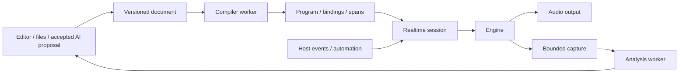

# Flows architecture

Source describes an event-driven signal flow; the runtime handles buffers and sample loops. The same instrument can be played, inspected, auditioned at intermediate points, and compared through analysis expressions. For a source-guided explanation of the implementation, read the [learning guide](learn/README.md). The [example catalogue](../examples/ADCxGather/README.md) provides playable studies.

## System boundaries

| Component | Current implementation |
| --- | --- |
| Compiler | `src/compiler`: lexer/parser, typed mono/stereo graph, source spans, parameter/choice metadata, voice completion, analysis graph |
| Engine | `src/engine`: ordered C++ DSP kernels, including unison, LFO, and ADAA distortion; shared by offline, standalone, and plugin paths; independent of JUCE |
| Session | `RealtimeSession`: bounded queues, parameter updates, program replacement, held-note replay, capture and audition; a bounded bank serves independently selected sequencer lane sounds |
| Host | JUCE 8.0.7 device/MIDI/AU/VST3 integration; `FlowsProcessor` owns documents, workspace, macros, and background work |
| Editor | One WebView per native editor, with React layout, CodeMirror text views, and canvas observations |
| Analysis | Non-realtime worker calculates waveform, FFT, mel, power, and arithmetic from continuous capture |
| AI | Separate network worker uses bounded tools to search/read workspace instruments, compile, render, compare, and propose edits |

macOS standalone, AU, and VST3 are implemented. Wrapper adapters check pinned JUCE source hashes and generate copies in the build directory. They preserve VST3 parameter points and AU immediate/ramp schedules without editing the user's JUCE checkout. Plugin code uses hidden visibility, exporting only factory/entry symbols to avoid merging internal symbols with a JUCE host.

## Compiler and DSP

Unit (`scalar`, `pitch`, `hertz`, `decibels`, `seconds`, `boolean`), rate (`constant`, `event-held`, `sample-varying`), and channels (1 or 2) are separate. Arithmetic and select can broadcast mono to stereo; comparisons, conditions, and primitive control inputs must be mono. Channel routing uses pure graph nodes. Pitch and decibel conversions are explicit nodes; envelopes, glide, and dynamic cutoff advance per sample.

`.make()` creates independent state. A stateful instance is called once in a kernel, then its result is reused. Static classes expand during compilation. `register_knob` describes defaults, range, step, scale, and update behavior. Pure `if` becomes select nodes; branches cannot create or call stateful DSP. Invalid references, units, recursion, duplicate calls, and unknown parameters produce source diagnostics.

Legacy sine/saw and a bare `unison: 1` remain mono. Larger unison counts or explicit stereo controls select the extended oscillator, with separate phase lanes and L/R output. LFO has five shapes, four modes, delay/fade, and Hz or tempo sync. Host BPM, PPQ, and play state reach the engine; internal tempo is used when host tempo is unavailable. Softclip, hardclip, and fold use first-order ADAA with independent channel memory. Filters, distortion, and audition preserve stereo. Effects currently run per voice before mixing; there is no global post-mix FX chain.

`Program`, runtime state, and parameter slots are separate. The current backend keeps scratch storage for every node and caches unchanged pitch/gain conversions. It has no general common-subexpression elimination, scratch-lifetime reuse, SIMD fusion, or JIT. Future optimization must preserve independent state, event timing, and named observations. Fast-math is disabled by default.

Compiler budgets include 1 MiB source, 256-byte identifiers, 128 Ki tokens, 2048 class expansions, 8192 expanded statements/named signals, and 16384 DSP/analysis nodes. Nested classes share the token stream and cannot expand without a bound.

## Sample resources

The compiler records static resource paths in `Program.samples`; each sampler node references an index. It performs no file I/O. `engine/sample.cpp` validates and decodes bounded WAV/AIFF files before playback. The host resolves paths from the workspace root, checks containment, and shares immutable PCM across voices. Engine state contains playheads and trigger/region state, not separate copies of the recording. A shared 32-tap windowed-sinc table handles fractional playback and reduces aliasing under transposition; finite filter length limits rejection at extreme ratios. Unity-rate integer positions retain exact source samples.

`SampleAssets` imports supported native formats into managed WAV files and caches decoded PCM. Packages and recovery carry referenced audio, including historical source when the draft is invalid. Restore reuses identical assets and remaps references on a filename collision. Missing/corrupt files fail preparation and mute the affected instrument. Asset bytes are prepared off audio; the host copies its prepared state only when asked to save.

`PreparedProgram` combines DSP structure and decoded PCM identity. Live parameter edits preserve playback position; replacing the sample contents forces a new engine. Retired engines and their shared buffers are released on the worker. CLI and AI renders use the same decoder and sampler kernel.

## Events, voices, and resource limits

The engine uses an increasing sample clock. At the same sample, parameter updates precede note events; note events retain input order. VST3 points follow their interpolation contract, and AU preserves start offset, duration, and endpoint values.

Mono reuses one kernel. Legacy oscillator phase and filter memory persist; the extended oscillator initializes phase/random according to note onset. Poly allocates independent state per admitted note. Note identity is separate from voice slot/generation. MIDI 1 note-off uses channel/pitch FIFO matching, including rejected notes. Voice reclamation follows compiler-derived completion conditions: gate closed, envelope idle, and settled filter/distortion memory, and sample EOF as required by the output. A zero-valued sample is not a silence proof.

| Resource | Current bound |
| --- | --- |
| Voices / held identities | 32 poly voices including release, 1024 held IDs; reject newest when full |
| Events / automation | 256 each per host block; invalid/overflow paths reset and expose errors |
| Native program | 2048 DSP nodes, 256 states, 4096 completion nodes, 2048 analysis nodes; prepared on worker |
| Capture | 8 DSP roots, projected to Mid/Left/Right/Side for audio; 128 packets, up to 1024 samples per root per packet |
| Analysis | 4096-sample window; 128 dependencies per view, 512 selected nodes, 32 spectral transforms |
| Program lifecycle | Active/outgoing, newest candidate, two retirement slots; 20 ms same-document crossfade; worker destruction |

The callback uses prepared storage. It does not compile, access files, network, or wait for the GUI. A full retirement queue delays installation instead of forcing destruction on audio. Bounded work and heap tests support realtime design; they do not prove every graph meets every device deadline.

## Edits, versions, and recovery

| Change | Application |
| --- | --- |
| Live parameter | Same structure retains engine state and updates parameter slots with authored smoothing |
| Observation | Retains DSP; updates capture/analysis/audition selection |
| Structure | Worker prepares new state; audio installs it at a block boundary and crossfades within the same document |

Unison count and oscillator phase/random are structural parameters. Source revision, engine generation, parameter epoch, and observation epoch distinguish source identity, state replacement, and measurement continuity. Runtime automation is separate from authored literals. Retained engines preserve current host values and ongoing ramps. Unprovable macro mappings become unbound.

Structural replacement applies valid runtime values and replays accepted held notes in press order; new envelopes begin Attack. Rejected notes do not revive. Old release tails end with the outgoing fade. Compilation/preparation errors mute the affected instrument, clear its held notes and audition, and retain the draft with diagnostics. Repair requires a new note; keys pressed during failure do not replay.

Instrument activation clears old notes and telemetry and stays silent until the selected source is ready. Historical `playableSource` is retained for recovery and resource preservation; it is never an audio fallback. Unsaved valid source drives the instrument. Save only persists text/patterns and updates saved history; it does not compile, select or reset audio.

## Probe and analysis

Named signals and roots of authored probes can be captured, including named branches outside the output path and probed class inputs. Aliases do not run DSP again. A preallocated tap mask selects roots and audition signals. Capture carries revision/generation/epochs, value IDs, voice identity, sample interval, and sequence. Gaps and transitions reset measurement windows rather than stitching incompatible samples. Changing audio projection advances the observation epoch; control values are unaffected.

`probe`, `power`, `spec`/`spectrum`, `mel_spec`, and arithmetic form a separate analysis graph. FFT uses a Hann window and returns linear amplitude; power is mean square; mel is linear weighted power in 64 triangular bands. The current unit label is retained from the input, not expanded into squared physical dimensions. Base display reduction keeps at most 192 waveform extrema and 512 logarithmically distributed spectrum representatives. A separate triggered detail view retains up to 1024 samples. Transport-aligned scopes collect 256 min/max bins per beat on the worker, with explicit current/previous/missing ages; they do not feed analysis operators. UI-only spectrum ballistics use fixed dB axes and preserve signed analysis differences. Raw waveforms/RMS/peak can use a partial continuous window; FFT and `power` need 4096 samples. A control voice change resets its own history without erasing independent mixed audio.

Poly audio can be observed as a sum. Mixed control previews use `last_voice_control`; arithmetic/transforms require an explicitly selected voice. Inspector and Signal Flow share voice/projection selection and reject delayed frames from an older selection. Audio signals and direct audio probes support audition with original L/R; visual projection does not affect Listen. Control and derived analysis cannot be auditioned. Analysis cannot feed DSP.

Cards share at most eight distinct roots, not eight variable names. Compiler metadata includes `captureRoots`, `shape`, `unit`, `channels`, and `auditionable`. Host validation enforces capture/analysis budgets. Full queues record drops without blocking sound. UI Hold freezes measured display data only, not audio or analysis inputs.

Manual performance uses `captureMode: performance`. Capture follows engine voice activity and actual output through held notes, envelope release, sample completion and DSP tails. It has no one-beat deadline. A short quiet drain lets the FFT window and display response settle before `captureIdle` clears live history; an inactive free-running internal oscillator does not start acquisition. Manual capture does not synthesize transport position: its waveform uses a fixed time span, and only transport capture can expose a beat window and playhead. Spectrum previews follow current measured bins without retaining the attack's maximum. Authored spectrum, mel, power and difference operations continue to use captured samples, independently of display smoothing.

Transport playback enables continuous acquisition even when its lanes are muted. Stopping it discards transport history; subsequent live notes have their own performance capture. Explicit UI Hold freezes presentation while measurement and audio continue. It survives a new manual key or natural silence until Resume, but a changed instrument, observation selection or transport mode invalidates the old snapshot. Idle live data cannot return through gap fallback. Capsules, Signal Flow and Inspector share the same idle/live/held state calculation and transport-only beat availability. See [probe and display implementation](learn/05-probe-and-analysis.md).

## Editor and workspace

Native documents own source and undo. Each instrument retains its draft, history, macros, and last playable source. Two editor groups have their own tabs, cursor, and scroll; both can display one instrument. UI actions carry document ID, base revision, and gesture ID. Outgoing edits are acknowledged before activation; intervening typing stays with its document. Conflicts preserve the draft for explicit resolution. UTF-8 compiler spans become UTF-16 UI offsets against the matching revision.

Focus selects the keyboard instrument and Signal Flow. AI remains workspace-wide; an instrument can be attached explicitly as a reference. Inactive tabs retain metadata. The sequencer can follow this instrument or pin a separate `.flows` instrument or sample. Pinned playback uses its own session and keeps playing across editor focus changes; each lane can select its own sound. Closing a final dirty view offers Save/Discard/Cancel.

The compile worker prepares the selected sound, including immutable sample PCM.
The audio callback routes step events to its session and mixes the two stereo
outputs using fixed buffers. Source swaps release the previous pattern's notes.
Valid edits of the selected instrument update its sound; invalid drafts mute
the affected sound, including selected instrument and follow-active lanes. Probe Listen mutes the independent sequencer mix
while transport continues. Samples use the existing sampler at C3 by default. One-shot playback completes at EOF; optional Gate playback adds an ADSR with a 5 ms release. Lane volume and mute act on voice output with 5 ms ramps, independently of velocity; raw probe values remain exact. A separate metronome follows transport even when every note lane is muted.

Syntax highlighting, capsules, folding, outline, and Inspector help locate signals. Signal Flow topology is read-only. Knobs and numeric drags write source; one gesture is one undo. Pending drafts retain the last valid graph while disabling stale bindings and jumps. Fixed-range parameters are read-only.

CodeMirror completion uses `languageCatalog.ts` and a tolerant source model, independent of successful compilation. It resolves import/key aliases, per-scope instances, inherited primitives and authored typed ports. Members, call parameters, enums, library imports, sample paths, units and snippets share the source editing path. Every catalogued primitive port/enum/function is tested with the real compiler. Pending source drops stale inline widgets. Font changes, loading and layout changes explicitly request measurements; source ligatures are disabled so glyph and cursor positions agree.

`ChoiceDescriptor` is the source of discrete-option UI: authored span, owner, selected value, enabled choices/reasons, and an insertion recipe for omitted defaults. The host publishes choices per document. Editor and Signal Flow use the same source-edit/undo path. Choice metadata is excluded from DSP structure identity.

Dividers support dragging, keyboard adjustment, and double-click reset. Code font defaults to 16 px, with a 10–32 px range. Theme/font/split/sizes/visibility are persisted. Standalone macOS supports background transparency; plugins remain opaque. Native alpha mode is set before WebView attachment, and temporarily hidden pages stay loaded. See [Editor](../ui/README.md) for controls.

The workspace contains `.flows` source, settings, recovery, and instrument packages. Seven compact bundled instruments remain the reference examples; the [example catalogue](../examples/ADCxGather/README.md) adds hierarchical learning material. Imports currently resolve built-in DSP libraries only. Portable `.flowsinst` stores source, last playable source, preferences, and macro mappings/values, without depending on the original absolute path or saving instantaneous oscillator/envelope state. There is no arbitrary module/asset dependency-lock system.

DAW save reads a prebuilt immutable package plus a bounded runtime parameter overlay; restore validates/compiles on the worker. Standalone recovery periodically preserves up to 32 open documents and their saved/draft/playable sources. Group layout uses stable workspace identity. Undo is process-local. External JSON is bounded by bytes, depth, and value count.

## AI and evidence

`AssistantHistory` keeps workspace-local conversations in `.assistant-history.json`. It merges under an inter-process file lock and saves through a temporary file. Conversations can be renamed, archived, moved to Trash, restored or permanently removed from Trash. Request IDs route replies to their original conversation. Interrupted requests recover with an explicit status. History is separate from instrument/DAW packages and contains no connection credentials.

The frontend renders replies through React Markdown with GFM support. Raw HTML stays disabled. Code copying and explicit web-link opening use small native editor actions. Historical proposals are readable, but application still requires an in-memory validated proposal for the current document revision.

AI tools are `search_instruments`, `read_source`, `explain_signal_path`, `compile_snapshot`, `render_case`, `compare_observations`, and `propose_source_patch`. The model receives the user's prompt, bounded recent conversation turns, an optional source reference, and tool results. Search and read are limited to visible `.flows` files within the workspace; open drafts take precedence. Each search page scans at most 128 instruments / roughly 8 MiB and returns up to 40 matches plus a continuation cursor. There are no shell or browser tools. Proposals compile before review. Existing-file proposals identify their target and the digest returned by its read; applying them checks that target's source, even if editor focus changed. Stale proposals cannot overwrite newer edits.

Networking runs on a separate worker with timeouts, cancellation, and response/tool budgets. Endpoints allow HTTPS or strict loopback HTTP. `AIModels` saves endpoint/model profiles and the selected profile in `~/Library/Flows/ai-models.json`, shared across workspaces and app/plugin instances. Credentials are referenced by ID and stored separately in macOS Keychain. Atomic replacement and an inter-process lock protect settings; changing the endpoint clears its old credential. A running request retains its captured connection. Keys are excluded from instrument packages, history and model context. Offline AI rendering is limited to three seconds, 256 nodes, 32 states, eight voices, and eight observations. Tools return measured metrics, not claims of listening.

Validation separates language semantics, native/plugin integration, GUI behavior, listening, and performance. A local fake endpoint covers actual HTTP/tool/proposal behavior; a live model provider remains separate verification. The recorded Release engine benchmark at revision `10769fa` passed 67/72 budget groups with 40 deadline misses, although all p99 values met budget. Four reruns of only the worst group had no misses; the cause of the full-run misses remains unresolved. Performance acceptance is incomplete, and that report does not certify later binaries. It excludes the full device callback, GUI, Analyzer, and hot-swap. See [Validation](../test/README.md) for exact evidence and reproduction commands.

## Playback boundaries

Native playback uses a 1 ms voice onset window and a 3 ms correction at note and voice-end boundaries. DSP captures remain exact; raw CLI renders keep their existing semantics. See [boundary_smoother.hpp](../src/engine/boundary_smoother.hpp) for the algorithm and [boundary_tests.cpp](../test/cpp/boundary_tests.cpp) for regression coverage.

Parameter presentation response is published separately from DSP smoothing and DAW normalization. `control_scale`/`control_offset` select level, zero-compatible time/frequency, logarithmic or linear UI response; explicit class scales override automatic selection. Source dragging and graph knobs use `parameterMapping`/`parameterDrag`, and exact entry uses one validated input. See [editor interaction](../ui/README.md#interaction).
