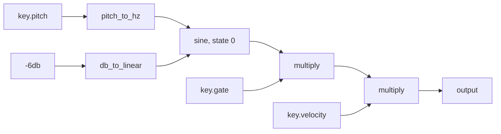

# 2. Follow source code into an executable graph

The compiler's main job is to turn one instrument file into a checked description that the engine can run and the editor can explain. It produces a `Program`, not native machine code. The current engine executes the graph's operations in C++.

Read [program.hpp](../../src/compiler/program.hpp) first: it defines the result in about 170 lines. Then follow the path through [program.cpp](../../src/compiler/program.cpp). The compiler is deliberately compact: syntax parsing, checking, and graph construction happen together. There is no separate, persistent syntax-tree representation between parsing and the graph.

## What is inside `Program`?

| Field | Purpose |
| --- | --- |
| `nodes` | Typed DSP operations, in dependency order |
| `states` | The memory each voice needs: oscillator, envelope, filter, LFO, distortion |
| `named_values` | Source signal names mapped to graph values |
| `output` | The graph value returned by the instrument |
| `voice_policy` | Mono/poly, trigger rule, glide duration |
| `completion` and `completion_root` | Conditions under which the output has finished |
| `parameters` | Numeric controls with units, ranges, defaults, update rules, source locations |
| `choices` | Discrete options and the exact source edits they represent |
| `analysis` and `named_analysis` | Probe expressions, separate from DSP |

After compilation, the program is treated as immutable. Running phase, filter memory, and changing parameter values belong to the engine. Keeping the description separate from its running state is what allows a compile worker to prepare a replacement while the audio thread continues using the current program.

Source: [`Program`, `program.hpp:140`](../../src/compiler/program.hpp#L140).

## Entry point: characters, tokens, graph

The actual entry point is short:

```cpp
return {Parser(Lexer(source).run(), std::move(source_path)).run(), {}};
```

This is the successful path inside [`compile`, `program.cpp:1071`](../../src/compiler/program.cpp#L1071). It first rejects source over 1 MiB. A language error throws an internal `Failure` with a source span and message; `compile` catches it and returns a failed `CompileResult`. It currently reports the first such diagnostic, rather than recovering to list every error in the file.

`Lexer::run` scans the characters into tokens: identifiers, numbers, punctuation, line breaks, and indentation changes. A token carries its original text and `SourceSpan`. Offsets and columns are byte-based here. The native UI bridge later converts editable ranges into the UTF-16 positions used by JavaScript.

The lexer ignores comments and blank lines, rejects tab indentation, and suppresses statement-ending newlines while inside parentheses. This makes a multiline call behave like one statement. An indentation stack emits `indent` and `dedent` tokens so the parser can recognize blocks.

Number parsing uses an explicit C numeric locale, independent of the operating system or plugin host's locale. It supports scientific notation and unit suffixes, rejects overflow and values that round from nonzero to zero, and preserves representable subnormal doubles. Units are normalized before graph construction.

Source: [`Lexer::run`, `program.cpp:46`](../../src/compiler/program.cpp#L46), [`Lexer::read_indent`, `program.cpp:121`](../../src/compiler/program.cpp#L121), [`quantity`, `program.cpp:181`](../../src/compiler/program.cpp#L181).

## The parser builds values as it reads

`Parser::run` accepts imports, class definitions, and top-level key-policy assignments before exactly one `Inst.sigstream` block. Within a block, `values_` maps signal names to an `Expr`; `instances_` maps `.make()` names to stateful instances. `Expr` is a small handle containing a graph index, an analysis/DSP flag, literal information, and a source span. It is not a tree containing the expression's children.

For an expression such as `raw * amp + sub`, precedence parsing first resolves the inputs, appends a multiply node, then appends an add node. Multiplication/division bind more tightly than addition/subtraction; comparisons have the lowest precedence. `Parser::append` assigns each new node its index in `Program::nodes`.

That construction gives a useful invariant: every input index is smaller than the consuming node's index. The graph is already in an order in which inputs can be computed before outputs. No later topological sort is required. `structural_invariants` in the tests checks the ordering explicitly.

While creating a node, the compiler checks units, derives rate, propagates channel count, and carries information about when its output can become finished. For constant expressions it also tracks the initial result in `Build::initial`. This supports range checks, structural constants, and division checks. It is not a general optimization pass that removes every constant or unused node.

Source: [`Build`, `program.cpp:228`](../../src/compiler/program.cpp#L228), [`Parser::run`, `program.cpp:245`](../../src/compiler/program.cpp#L245), [`Parser::expression`, `program.cpp:724`](../../src/compiler/program.cpp#L724), [`Parser::append`, `program.cpp:333`](../../src/compiler/program.cpp#L333).

## An exact trace: the sine reference

Run this from the repository root with the existing app build:

```sh
./build-app/flows compile test/presets/sine-reference.flows
```

To save the graph, add `--ir /tmp/flows-sine.ir.json`. The JSON is a readable serialization of the compiler's intermediate representation, or IR: the checked program between source and execution. It is useful for understanding the implementation, not a second source language you need to author.

For the current [sine-reference](../../test/presets/sine-reference.flows), the compiler emits the following nodes. These indices were checked against the CLI output, not inferred from the diagram.

| ID | Operation | Inputs | Meaning |
| --- | --- | --- | --- |
| 0 | `key_pitch` | — | MIDI pitch |
| 1 | `key_gate` | — | Held state |
| 2 | `key_velocity` | — | Velocity |
| 3 | `key_trigger` | — | Restart pulse, present even though unused here |
| 4 | `parameter` | — | Authored `unison: 1` |
| 5 | `parameter` | — | Authored `level: -6db` |
| 6 | `pitch_to_hz` | 0 | Convert pitch to frequency |
| 7 | `db_to_linear` | 5 | Convert decibels to amplitude |
| 8 | `sine` | 6, 7 | Oscillator using state 0 |
| 9 | `multiply` | 8, 1 | Apply gate |
| 10 | `multiply` | 9, 2 | Apply velocity; instrument output |

`.make()` created `states[0]`, named `mOsc1`; it did not itself create an audio node. The call created node 8, whose `state_index` points to that memory specification. `raw` names value 8, and `$output` names value 10. The explicit `unison: 1` parameter remains in the program even though this legacy mono oscillator needs only frequency and gain inputs. Its role is a checked structural control for later edits.



Source: [`Parser::instance_call`, `program.cpp:877`](../../src/compiler/program.cpp#L877), `sine_regression` in [compiler_tests.cpp:29](../../test/cpp/compiler_tests.cpp#L29).

## State and class expansion

`assignment` recognizes `Class.make()` before ordinary expressions. For a built-in, it appends a `StateSpec`. Calling that instance marks it as called and creates its DSP producer. A second call is rejected. Different `.make()` declarations therefore produce different state identities even when their parameter values match.

A composition class is different: its definition stores typed ports and the token range of its `signal` body. `composition` creates a child parser over that range, binds the actual inputs to the ports, and expands the body into the same `Program`. It prefixes internal names with the instance path: two layers can contain `one.osc` and `two.osc` without sharing oscillator state.

Defaults are resolved at the outside of the composition first. The compiler records that ownership so a built-in deeper inside cannot silently replace the outer port's reset value. Registered ranges intersect when a literal serves more than one constrained use; incompatible ranges cause a diagnostic.

This is compile-time expansion, not a second object system running in the audio callback. Recursive composition is rejected, and the expansion depth and count are bounded.

Source: [`Parser::parse_class`, `program.cpp:552`](../../src/compiler/program.cpp#L552), [`Parser::composition`, `program.cpp:1012`](../../src/compiler/program.cpp#L1012), `classes_and_metadata` in [compiler_tests.cpp:112](../../test/cpp/compiler_tests.cpp#L112).

## A voice needs an ending condition

A note-off cannot always delete a voice immediately: an envelope may still be releasing, or a filter may hold energy. The compiler builds a small second graph describing when the returned output is finished. `Build::zero` records a known ending condition for each DSP value; `Program::completion` stores the combined conditions.

This is a conservative construction based on signal structure. It does not solve arbitrary mathematical identities, and “unproven” does not mean the author intended an endless sound.

| DSP operation | Ending condition propagated by the compiler |
| --- | --- |
| `key.gate` | Gate is closed |
| Key-controlled ADSR | Envelope has reached idle |
| `a * b` | Either known input ending condition is satisfied |
| `a + b`, `a - b` | Both inputs need known ending conditions; both must finish |
| `stereo(a, b)` | Both channels must finish |
| A filter after a finite input | Input finished **and** filter state settled |
| Distortion after a finite input | Input finished **and** distortion memory settled |
| `select(condition, a, b)` | Both branches must have ending conditions; both must finish |

The table describes the compiler's implemented rules, not general algebraic theorems. In particular, a literal zero does not automatically prove every expression that contains it has a lifetime. The engine evaluates the resulting completion conditions while processing.

Consider these two routes, expressed as pseudocode:

```text
filter(raw) * envelope
    output ends when the final envelope is idle

filter(raw * envelope)
    output ends when the envelope is idle AND filter memory has settled
```

The first route gates the whole filter output. The second leaves the filter after the envelope, so its remaining state contributes a tail. This is why processor order affects both the sound and voice cleanup.

`parse_instrument` requires a known completion root for poly mode. `return raw` in a poly instrument is rejected; `return raw * key.gate` or a key-controlled ADSR supplies an ending condition. Mono is allowed without this proof. The UI also disables a mono-to-poly choice when the current source lacks the required proof.

Source: [`Parser::append`, `program.cpp:333`](../../src/compiler/program.cpp#L333), [`Parser::parse_instrument`, `program.cpp:628`](../../src/compiler/program.cpp#L628), [`CompletionExpr`, `program.hpp:76`](../../src/compiler/program.hpp#L76), `conditional_and_completion` in [compiler_tests.cpp:90](../../test/cpp/compiler_tests.cpp#L90).

## Why the editor knows where a knob belongs

An authored numeric literal becomes a `parameter` node plus a `ParameterDescriptor`. The descriptor contains a binding ID, source span, unit, range, step, default, smoothing duration, and live/rebuild flag. For the sine file, `raw.literal1` identifies the authored `-6db` value; it is a level control with a 0 dB reset value and 5 ms smoothing metadata.

A source span includes the minus sign and suffix. The UI can therefore replace `-6db` precisely, preserve its written unit, and record an ordinary source edit for undo. A binding ID is tied to an authored context and literal order, not a universal identity across arbitrary source rewrites. The UI and native session must still check document and revision before applying an edit.

Some inputs change the DSP structure or note-start configuration. `structural_parameter` follows their dependencies and marks contributing authored parameters as rebuild-only. Examples include unison count, oscillator initial phase/randomness, and LFO bipolar configuration. A DSP divisor's dependencies are also rebuild-only so recompilation can recheck that the denominator is nonzero.

Discrete choices use a related descriptor. `ChoiceDescriptor` lists the available spellings, selected spelling, owner signal, and replacement span. An omitted default has a zero-length span plus a prefix/suffix for insertion, such as adding `, mode: highpass` before a call's closing parenthesis. The editor does not maintain a separate hidden filter mode.

Disabled choices carry reasons. For example, an LFO cannot switch to `retrigger` without an explicit trigger signal, or to `transport` without `sync`. When multiple expanded class instances refer to one authored span, `reconcile_choices` merges their restrictions: changing that one piece of text must remain valid for every use.

Source: [`ParameterDescriptor`, `program.hpp:82`](../../src/compiler/program.hpp#L82), [`ChoiceDescriptor`, `program.hpp:106`](../../src/compiler/program.hpp#L106), [`Parser::constant`, `program.cpp:373`](../../src/compiler/program.cpp#L373), [`Parser::register_range`, `program.cpp:416`](../../src/compiler/program.cpp#L416), [`Parser::reconcile_choices`, `program.cpp:291`](../../src/compiler/program.cpp#L291).

## Probe expressions do not become audio operators

The parser marks observation assignments as analysis expressions. `probe(raw)` creates an `AnalysisNode` whose `signal` points to `raw`'s existing DSP value. It does not call the oscillator again. `power`, `spectrum`, `mel_spectrum`, and analysis arithmetic append to `Program::analysis`, with their own indices and output shapes.

Shape checking prevents accidental combinations such as a waveform minus a spectrum. Analysis literals become scalar analysis nodes and can broadcast. `require_dsp` prevents an analysis result from feeding the realtime graph; `as_analysis` requires an explicit probe before a DSP signal can enter an analysis expression.

The UI/analyzer can inspect and evaluate this second graph without altering the instrument's DSP connections. The runtime chapter explains which samples are captured and how the transforms are calculated.

Source: [`Parser::analysis_statement`, `program.cpp:684`](../../src/compiler/program.cpp#L684), [`Parser::analysis_call`, `program.cpp:788`](../../src/compiler/program.cpp#L788), [`Parser::binary`, `program.cpp:807`](../../src/compiler/program.cpp#L807).

## Decide whether an edit needs a new engine

`dsp_structure_key` copies the program, removes source locations, named views, analysis, and choice presentation metadata, and clears the authored values/defaults of live parameters. It then serializes that normalized program to a comparison string. This is a structural comparison key, not a cryptographic hash or a general equivalence proof.

| Edit | Typical structural result |
| --- | --- |
| Add a comment or move a source line | Same |
| Add probe expressions | Same |
| Change a live level value | Same |
| Change unison count or oscillator initial phase | Different |
| Change mono/poly policy | Different |
| Rename a stateful instance | Different, because state identity changed |

Removing choice **metadata** from the key does not make changing a chosen mode a live edit: the selected mode also changes an operation, flags, or policy. Those remain structural. The session compares this key together with document/sample-rate context before choosing state reuse or replacement.

Source: [`dsp_structure_key`, `program.cpp:1195`](../../src/compiler/program.cpp#L1195), [`RealtimeSession::install`, RealtimeSession.cpp](../../src/host/app/RealtimeSession.cpp). Search for `const bool same` in the latter when tracing the handoff.

## Bounds and tests

The compiler imposes finite work limits so malformed or excessively expanded source cannot grow without limit:

| Limit | Current value |
| --- | --- |
| Source size | 1 MiB |
| Tokens / identifier length | 131,072 tokens / 256 bytes |
| Expanded statements / named signals | 8,192 each |
| DSP nodes / analysis nodes / discrete choices | 16,384 each |
| State records per voice | 4,096 |
| Class expansions / simultaneous expansion depth | 2,048 / 16 |
| Expression nesting | 256 |

These are rejection bounds, not recommended patch sizes or performance promises. The engine additionally validates its prepared graph and memory budget. There is currently no general dead-code elimination, vectorizing compiler, or native-code JIT in this path; those would be further work.

To verify this layer with the existing build:

```sh
ctest --test-dir build-app -R '^compiler$' --output-on-failure
```

The tests check graph order, exact literal spans, units, defaults, class expansion, voice completion, analysis separation, structural identity, numeric boundaries, and rejected programs. `all_enabled_choices_compile` actually substitutes each enabled dropdown value back into source and recompiles it. `repository_examples` also checks that the five complete examples in [LANGUAGE.md](../LANGUAGE.md) exactly match their playable preset files.

For focused navigation, read `sine_regression`, `conditional_and_completion`, `observations_and_identity`, `resource_budgets`, and `discrete_choices` in [compiler_tests.cpp](../../test/cpp/compiler_tests.cpp). These tests capture the current contract more precisely than a claim that the language supports “arbitrary DSP code.”
